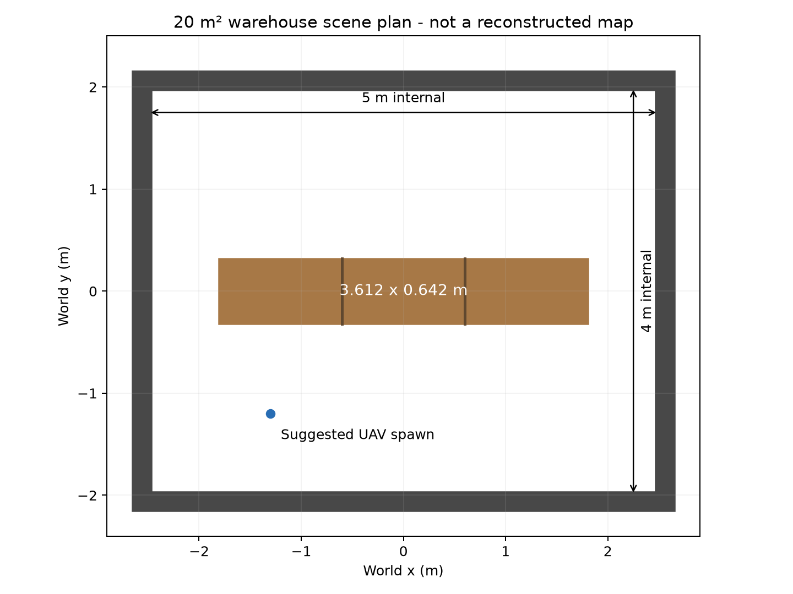
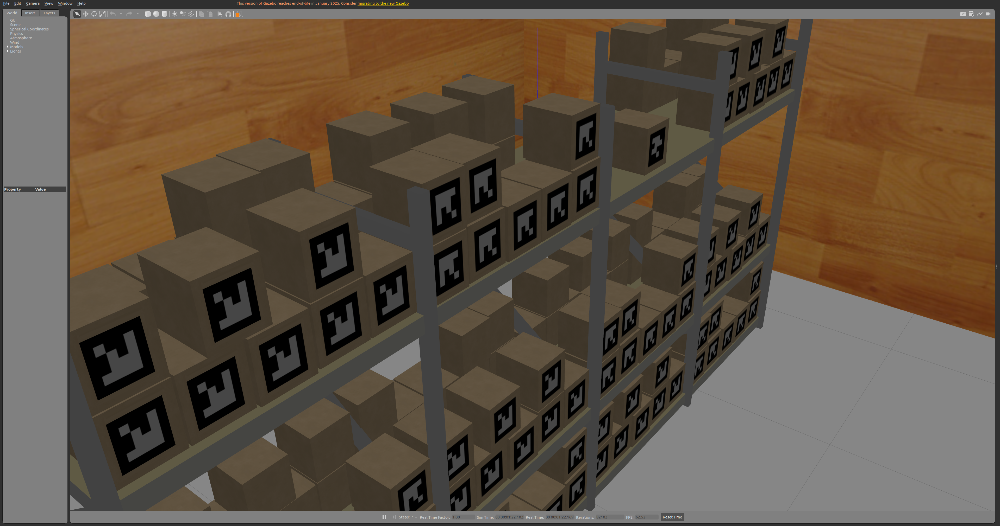

# 20㎡单货架仓库

已完成20㎡单货架的SITL离线地图/3DGS重建，结果在`roomgs_runs/warehouse20_20261102_reconstruction`。固定4407个20cm外露表面目标，地图和学习后高斯均100%支持、缺0；完整性不指遮挡内部或无限细节。采用保留的原生主图和低流量多航次补充观测，不冒称新606站单次完整飞行成功。资源、实际失败历史和离线复跑命令见[资源与结果说明](ROOMGS_RESOURCES_CN.md)。


## 场景

- 世界文件：`simulation/astra_gazebo_worlds/cangku_20sqm.world`。
- 净室内尺寸：5m × 4m，面积20㎡，室内高度3m。面积按内墙面之间计算。
- 家具：一个原仓库的 `shelf_aruco` 实例，保留其层板、纸箱和 ArUco 纹理，无行人及其他家具。
- 货架实际网格尺寸约3.612m × 0.642m × 1.819m，原始网格与缩放比例不变，移至房间中央。
- 封闭四壁、实体地面与天花板。墙面沿用原仓库的木纹材质。
- 货架的可见几何和碰撞几何使用同一个静态三角网格；Gazebo 运行时信息已确认两者均为 MESH。尚未进行实际雷达逐射线检查。

传感器沿用仓库已有仿真配置：`mid360.sdf` 的 `vertical_angle_offset_deg=15` 使模拟扫描俯仰范围约为−22.2°至+37.2°，不等同于原装MID360视场。此项本轮没有改动；本轮结果只验证该仿真配置，迁移实机须使用实际安装标定和视场重新规划/验收。

原 `cangku.world`、`cangku_half.world` 和货架资源保留；新的小场景采用独立文件，避免影响旧入口。生成器是 `integration/roomgs/warehouse20.py`，参数及范围说明在同名 `cangku_20sqm.json` 中。





## 打开场景

```bash
cd /home/a/AstraDroneOpen
bash scripts/run_sh/warehouse20_preview.sh
```

仅启动静态 Gazebo 世界，不启动 PX4、ROS 控制器、SLAM 或训练。关闭窗口或按 Ctrl-C 退出。私有 Gazebo master 默认使用端口11365；需要更换时设置 `ASTRA_WAREHOUSE20_MASTER_URI`。

无界面加载检查：

```bash
bash scripts/run_sh/warehouse20_preview.sh --headless
```

重新生成场景：

```bash
/usr/bin/python3 integration/roomgs/warehouse20.py
gz sdf -k simulation/astra_gazebo_worlds/cangku_20sqm.world
```

## 地图重建入口与结果

重建入口已适配为：

```bash
bash scripts/run_sh/warehouse20_reconstruction_demo.sh --headless
```

实际顺序：新世界/出生点 → R3LIVE反馈飞行采集 → 落地上锁 → 原生地图/精确RGB光学位姿导出 → 严格表面验收 → 离线gsplat → 留出/新视角渲染 → 独立模型后审计。`--capture-only`只采集，`--train-only /航次目录`只训练已通过的航次。当前`roomgs_demo.sh`默认也使用warehouse20，原11×12m房间须显式`--scene room`。

本次是**已知模型离线规划的巡检重建**：飞行前用三角网格选择补拍视点，飞行仅读取数字航点和传感器定位；不是未知房间自主探索。R3LIVE和gsplat不读取网格或真值位姿，真值网格用于离线规划/验收，单次初始坐标对齐仅用于审计。

采集前固定20cm表面单元/法向/部件的实际三角面代表点：5837原始目标中，4407个在独立安全机体站位/实际相机能力域内满足双视角/40cm基线，1430个遮挡、贴地或域内不可观测目标保留掩码并排除验收。目标选择不读取选定飞行路线或已采数据，采集后不能删减分母。旧517航点/245.43m实飞完成，几何4407/4407但照片缺31，未通过。当前计划606航点、129.26m，针对31个缺观测位置增加上下/横向扫拍，其中300站延长停留；理想预检4407/4407通过，尚不能替代实际验收。实测仍要求每个固定目标有20cm内原生地图点及至少两个实际可见视图/40cm位置基线，缺一即拒绝训练。

`warehouse20_audit.py`和`warehouse20_plan.py`使用隔离环境的trimesh/embreex/rtree；`mesh_reference.npz`、`target_manifest.json`记录固定目标及全部排除项。早期过密三角采样、首帧基线造成的预检失败保留在`evaluation/warehouse20_20261101/`，未将预检失败或理想成功冒充实际运行结论。

货架端部到墙的净距约0.694m，旧外围巡检路线不能简单缩放后使用；需结合实际机体尺寸规划跨越货架或分区扫描。货架是带层板和空隙的网格，不能沿用实心家具包围盒作为完整性验收面。场景元数据只供离线几何检查，不能代替估计器位姿或观测地图。

## 清理与验证记录

按本轮要求，旧 RoomGS 的全部航次（包括最新一次）的 bag、图像、地图、高斯模型、视频和评测输出已删除，旧 viewer 已停止。同步删除此前安装过程的下载/探查及私有浏览器缓存，共移除约33.84GiB分配空间；程序、已装训练环境、编译节点和其他历史实验保留。

清理清单、几何检查、Gazebo日志及截图在 `docs/维护记录/2026-11-01_20平米单货架仓库/`。早期 Gazebo 预览因缺少系统资源路径失败，入口补齐系统 Gazebo 环境后实际加载成功；保留更正记录。原仓库SHA256仍为 `2ea8635e9f1cf6e50e7cb7238eb98e4abcec2e2523683a5304a1307b39736f11`。

旧实验的历史文字摘要保留在交流记录中；旧数值不代表新仓库的重建效果。本轮无新增算法或性能对比结论。
