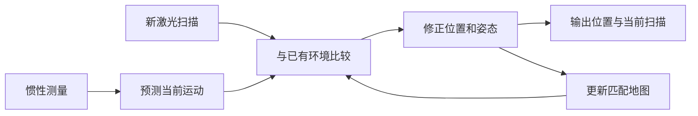
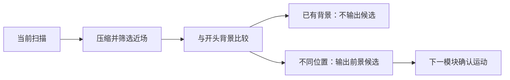
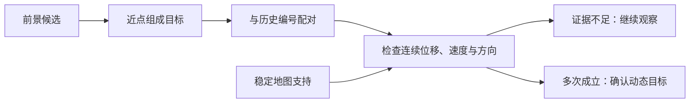
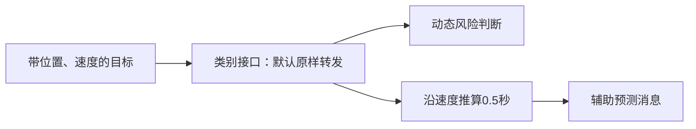
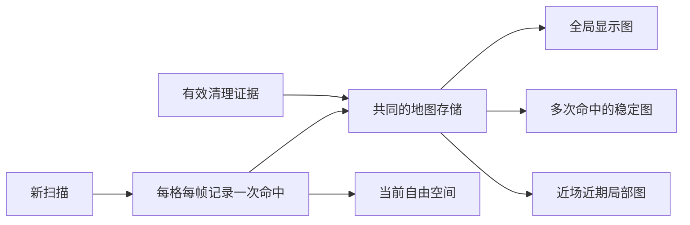
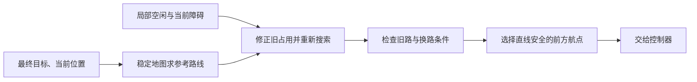
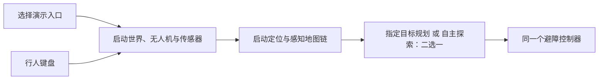
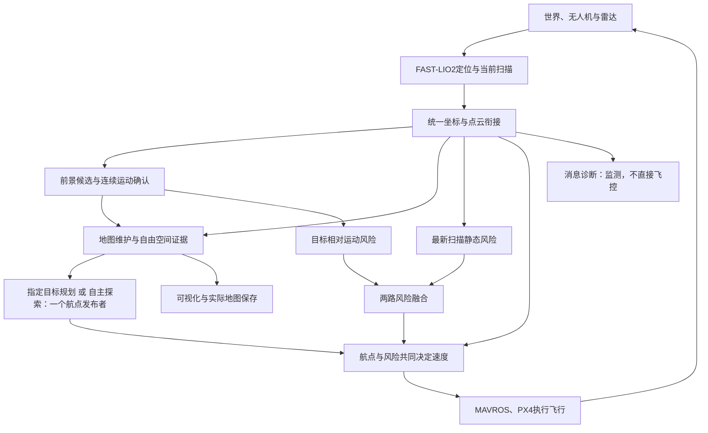

# 无人机建图、避障与探索：功能包作用和运行规则

编写日期：2026-10-10。依据当前工作区源码与启动配置整理。本轮只制作讲解材料，没有修改飞行程序、重新飞行或新增性能实验。流程图是源码关系示意，不是实验结果。

## 先分清“功能包”和“模块”

上一轮列出的八个避障文件，其实大多属于同一个功能包 `fastlio_bridge`，不是八个独立的包。可以把功能包理解成一个工具箱，把里面的程序理解成各自负责一件事的小工具。

主要有四类工具箱：`FAST_LIO` 负责估计无人机的位置并整理扫描；`fastlio_bridge` 负责把位置和点云接入动态判断、地图更新、规划与控制；`astra_uavoffbard_frame/offboard` 保存键盘、指定位置和预设航线等飞行示例；仿真相关包负责提供仓库、无人机、雷达和行人。仿真世界提供物理环境，但探索器不直接读取货架的真实布局来选路。

下文所称“主目录”为 `/home/a/AstraDroneOpen/AstraDrone_ros1_ws/src/SLAM/fastlio_bridge`。模块名称采用讲解用中文名称，准确程序名保留在“源码”处。

## 1. 定位与原始建图：回答“我在哪里”

FAST-LIO2 把惯性测量和激光扫描放在一起使用。惯性测量帮助预测短时间内的运动；新的激光扫描再与已有地图比较，用环境表面的位置关系修正预测。因此位置不是只靠惯性积分算出来的，也不是单纯把每一帧点云拼在一起。

它输出位置、姿态以及转换到统一参考系的当前扫描，为后续判断物体有没有运动提供基础。在当前仿真主演示中，模拟点没有真实逐点采集时间，代码走模拟雷达分支，不能把一般算法中的逐点运动补偿说成该演示已经执行的步骤。

源码：`/home/a/AstraDroneOpen/AstraDrone_ros1_ws/src/SLAM/FAST_LIO/src/laserMapping.cpp`、`src/IMU_Processing.hpp`、`src/preprocess.cpp`。

## 2. 坐标与点云衔接：让各模块说同一种“位置语言”

定位程序和飞控的坐标原点不一定一致。如果一个程序说障碍在左边，另一个程序却用不同方向理解“左边”，控制就会出错。衔接程序在初始化时建立坐标转换，把无人机位置和当前点云都转换到同一个地图参考系。转换是实际旋转、平移数据，不是只改消息标签。

主演示用飞控位置完成一次初始对齐，之后由每帧激光定位结果独立驱动输出。当前不把这个已借助飞控对齐的位置再反馈给飞控，避免循环依赖。航迹记录也在这个统一参考系内，按间隔取样并设最大长度。

源码：主目录 `src/fastlio_bridge.cpp`、`src/cloud_bridge.cpp`；装配：`launch/perception.launch`。

## 3. 前景候选：先找到“与开头环境不一样”的点

这个程序先收集开头若干帧，把当时看到的位置记为背景；当前配置为40帧。后续扫描先按小空间格压缩，再限制到无人机附近一定距离与高度范围，减少远处结构和地面干扰。点所在的小格及附近格如果已经在背景中，就不作为前景；否则交给下一模块继续判断。

这里的前景只是候选，不等于正在运动。无人机绕到货架另一面时，新出现的静止表面也可能是候选。当前关闭永久在线背景吸收，避免行人短暂停下后被永久当成背景。开头已经存在且不动的人也可能进入背景，不能把该程序称为人体识别器。

源码：主目录 `src/dynamic_detector.cpp`；参数：`config/dynamic_detector.yaml`。输入当前扫描，不输入累积全图。

## 4. 聚类与连续跟踪：从“点变了”判断“物体在走”

聚类就是把距离较近的候选点组成一组，再用这组点的中心代表一个目标。程序把本帧目标与历史目标配对，为同一目标保留编号；配对也检查合理位移和速度，避免把不同物体强行串成一条轨迹。

运动判断要同时看一段时间内的位移、速度、方向是否稳定，以及中心是否符合连续移动。单帧突然多几个点不会立刻判为动态；当前普通和近场都要求连续4次运动条件成立。稳定地图中已有充分支持的表面还会否决动态判断，帮助抑制树叶、货架边缘等误报。这个保护也可能压制被地图支持的真实移动目标，需要后续单独评价漏检。

显示位置使用较快平滑，运动判定历史使用另一套较保守平滑，所以显示更新速度与动态确认速度不是同一个参数。目标丢失超过允许帧数会删除，不把旧编号永久显示。该程序已经负责跟踪，主演示没有再串联另一个独立跟踪器。

源码：主目录 `src/dynamic_cluster.cpp`；参数：`config/dynamic_cluster.yaml`。

## 5. 短时位置预测与类别接口：当前是辅助支路

短时预测程序假设目标短时间内速度不变，沿当前速度向前推算0.5秒的位置。它输出辅助预测消息；当前主要碰撞判断直接读取目标的当前位置和速度，自己计算相对接近情况，不是等待这条预测消息再工作。突然加速、转身或停下都会使简单外推不准确。

类别接口在关闭时原样转发目标；开启并收到有效相机参数、类别框与坐标转换时，才尝试把三维目标对应到图像框并附上类别。默认主演示关闭该功能；接口本身不运行人体识别网络。不要因输出话题名字含“semantic”就说系统已经用神经网络识别人。

源码：主目录 `src/dynamic_predictor.cpp`、`src/semantic_fusion.cpp`；开关和0.5秒参数：`launch/perception.launch`。

## 6. 动态碰撞判断：关心“会不会朝我靠近”

程序不仅检查现在相距多远，还把目标速度减去无人机速度，判断双方在未来短时间内会不会接近、最近会相距多远，并检查高度上是否可能相遇。当前预测时间范围为1.5秒，普通水平安全距离为1.35米；这两个距离相关规则主要基于目标中心，不是根据每个人的完整形状精确计算碰撞。

靠近但还未紧急时发布预警；现在已经很近，或预计很快近距离相遇时升级为紧急。程序暂时锁定主要威胁，并设置更大的解除距离和短保持时间，减少目标编号、方向及等级来回跳变。输出是风险等级与建议避让速度，最终是否执行由控制器决定。

源码：主目录 `src/collision_risk.cpp`；参数：`config/dynamic_risk.yaml`。

## 7. 静态碰撞判断：用最新扫描看“附近是否太挤”

它主要读取最新扫描，不等慢速累积地图更新。先选择巡航高度附近的点，在近距离点周围寻找足够多的支持点，使用支持距离的中间值减少孤立噪点影响。已确认动态目标附近有短时掩膜，减少同一人同时被两路风险重复解释；这种掩膜也有有效时间，当前扫描仍保留在探索和控制的额外检查中。

距离减去设置的无人机水平半径，才是用于判断的机体外缘余量。仓库配置半径0.40米，预警、紧急、解除分别相当于机心距表面约0.70、0.65、0.75米。解除门限大于进入门限，用来防止边界抖动。它是近场快速检查，不能取代路径规划，也不证明遮挡区域没有障碍。

源码：主目录 `src/static_collision_risk.cpp`；参数：`config/static_risk.yaml`，仓库覆盖项见 `config/warehouse_navigation.yaml`。

## 8. 风险融合：把两路意见变成一套输出

融合模块接收静态、动态两路风险和建议速度，取较高的风险等级。只有一路需要避让时使用该路建议；两路同时预警时组合建议；同时紧急时按权重组合。如果两个紧急方向几乎抵消，优先采用静态紧急方向。输出速度还经过平滑和限幅。

风险等级的“取较高”不代表速度只简单选较高那一路，两路同时触发有专门规则。过期来源不参与本次选择，融合器本身不证明感知断流时安全；控制器另有位置、风险和扫描新鲜度检查。这一模块也不计算绕货架的长路线。

源码：主目录 `src/avoidance_fusion.cpp`；参数：`config/avoidance.yaml`。

## 9. 地图维护：让“曾经有障碍”可以被更新

维护程序把每次扫描存入小空间格，记录不同帧的命中、最近被看到的时刻和后来看到它为空的证据。同一帧中很多点不能代替多帧确认。默认全局显示需要2帧命中，稳定层需要8帧；局部层接受短时观测，但只保留无人机附近、最近仍被观测的点。

全局图、稳定图和局部图来自同一份格子存储，只是取出条件不同，不是三套完全独立的地图。自由空间输出表达当前射线经过的空区域，规划器可以用它纠正旧占用。此处维护的 `/uav1/fastlio/cloud_map` 是衔接包发布的导航地图，不等于回写修改 FAST-LIO2 内部用于定位匹配的地图。

源码：主目录 `src/static_map_builder.cpp`；参数：`config/static_map.yaml`。

## 10. 鬼影清理：区别“没扫到”和“确实看到这里空了”

早期普通导航演示可以使用两类清理：确认动态目标的历史轨迹范围清理，以及多次射线穿过旧占用后的清理。前者清得快，但可能顺带删除行人附近的静止结构。因此仓库探索启用较保守模式，不依据运动轨迹圆柱直接删图。

探索模式把当前扫描与采集时间接近的无人机位置配对，从真实雷达原点向真实回波构造射线。只有射线确实经过旧点附近、离回波末端有余量、旧点近期没有再次命中、附近当前回波也没有支持时，才增加一次“这里为空”的证据。普通点达到3次、稳定点达到6次才删除；间隔过久重新累计。当前回波命中会清零该点的空闲证据。

没有回波的角度、遮挡区、未重访区域不自动算空。稳定的人仍是真实障碍；人离开后也要重新看见旧位置才有机会撤销。导出地图不会再按人体真值裁剪出一个好看的结果。

源码：主目录 `src/static_map_builder.cpp::updateEvidenceFreeSpace`；探索覆盖开关：`launch/warehouse_exploration.launch`。

## 11. 指定目标规划：计算“怎样绕过去”

通用规划器把巡航高度附近的点投到平面格子，并给障碍加上包含机体尺寸的安全余量，用 A* 搜索到指定目标的路线。先利用稳定地图求参考路线，再依据局部自由空间撤销有证据的旧占用，叠加当前局部障碍后重新求路。先清理原始三维占用，再扩大障碍范围，不能直接把膨胀区域随意擦掉。

仓库中较小搜索范围无路时，范围可以逐级从4米扩大到8米、12米；只是扩大计算区域，不是把未知区域宣布为空。旧路线仍可走时，只有新路线明显缩短才换边；旧路被新障碍挡住时则立即重算。控制航点要沿当前安全直线段选择，不能跨折线直接切角。

这是一种固定高度附近的平面路线规划，不会自主升高越过货架。它使用指定最终目标；自主探索演示关闭该程序，由探索器单独发布航点，避免两个程序抢着指挥。

源码：主目录 `src/static_path_planner.cpp`；参数：`config/path_planner.yaml`、`config/warehouse_navigation.yaml`。

## 12. 自主探索：在未知环境中自己挑下一站

探索器开始时只有有限计算窗口，没有仓库形状与货架位置先验。自由射线更新已经看到的空区域，最新扫描和维护地图提供障碍。随着真实观测靠近窗口边缘，窗口扩大；新格子仍是未知，不可直接飞进去。

它在已观测安全区域内搜索可达路线，找接近未知边界的观察位置，比较能看到多少未知区域以及到达需要多远，再选择下一站。到达后短暂停留收集扫描，更新地图，再决定下一站。如果目标长期没有进展，暂时屏蔽并换目标，避免一直盯着同一货架。

正常安全余量仍为0.80米。新扫描使起点落入扩大的障碍区时，只允许在已知空间中寻找净空不减少的短退路，并由控制器用最新扫描再次检查。恢复下限0.45米仅用于有条件短退让，不是把日常路线的安全距离降为0.45米。当前探索飞行速度上限在启动文件中覆盖为0.30米/秒。

源码：主目录 `scripts/warehouse_explorer.py`、`scripts/exploration_grid.py`、`src/exploration_search.cpp`、`scripts/exploration_native.py`；参数：`config/warehouse_exploration.yaml`。

## 13. 补扫与结束：区分“任务结束”和“地图完整”

探索器同时观察新自由面积和新表面是否继续增长。如果一段时间内增益很少，进入补扫，优先再看已经发现、但观察次数或方向不足的表面。补扫强调多个采集时刻、至少两个方向和一定观察基线，而不是仅飞到附近一次就算看清。

只有无有效前沿、无需要补扫的可达目标、增益足够低、当前已测表面质量达到要求且没有相关失败或资源限制等条件满足时，才声明已观测可达区域收敛。达到预算上限或人为限制也会返航，但明确标为部分结果。返航在起点0.30米内连续停留5秒，并确认地图保存，才进入任务完成状态；返航被阻挡或超时不算成功。

当前表面质量分母只包含已经看到的表面，不含从未扫到的货架，所以不是全仓库完整率。独立地图审计负责比较参考表面，不能用“已返航”或“文件已保存”替代覆盖验收。

源码：主目录 `scripts/warehouse_explorer.py`、`scripts/exploration_coverage.py`；独立审计 `scripts/warehouse_map_audit.py`。

## 14. 飞行控制：把“下一站”变成速度命令

控制器先等待位置与地面高度稳定，持续发送控制设定，然后申请外部控制模式和解锁。起飞要结合实际空中状态及高度稳定确认，不能仅根据一个错误高度差声称已经离地。起飞完成后，根据当前位置与航点差计算速度，同时单独保持高度并限制速度。

风险正常时按路线前进；预警时默认水平悬停让行，只有符合检查条件的静态恢复可以短退让。普通导航紧急时可以执行融合建议；仓库探索开启紧急水平停车，仅在探索器授权且扫描再次检查通过时才做短恢复。位置、风险或必要扫描过期时保持，不继续盲飞。当前探索普通前进还用新鲜扫描检查前向净空。

中间拐点和最终目标容差不同，避免提前把拐点当成终点停车。最终速度通过 MAVROS 送给 PX4，底层飞控再执行姿态和电机控制；本程序不是直接控制电机的全部飞控。

源码：主目录 `src/mavros_avoidance_controller.cpp`；参数：`config/astra_mavros_controller.yaml` 和两个仓库覆盖文件。

## 15. 显示与运行监测：让问题看得见

显示程序把当前扫描、维护地图、已飞航迹、规划路线和动态目标放在同一地图参考系中。目标球是检测结果的表示，不是雷达原始点，也不是精确人体轮廓；采用编号和短生命周期，目标消失后不留下永久球。自主探索中的青色点是候选观察位置，不是地图点。

监测程序统计位置、扫描、动态目标、风险和建议速度消息是否持续到达，并发布诊断状态。空目标列表也可能表示环境中没有移动目标，不能因列表为空认定程序停止。监测输出主要用于告警，并不直接接管飞行；真正的停车规则在控制器内。

源码：主目录 `src/dynamic_marker.cpp`、`src/system_watchdog.cpp`、`src/fastlio_bridge.cpp`；显示配置：`rviz/astra_dynamic_avoidance.rviz`、`rviz/warehouse_exploration.rviz`。

## 16. 地图保存：保存实际维护结果，不另造“好图”

保存程序订阅维护地图，检查地图和当前扫描仍在更新，并取有限数值的三维坐标写入点云文件。空地图或过期数据拒绝覆盖上一次有效地图。先写临时文件，再替换正式文件，减少中断时留下半个文件的风险。

同时保存一个说明文件，记录来源话题、参考系、采集时刻、点数和校验值，便于确认离线点云对应哪次在线结果。它不做额外人体删除、不按仓库真值补点，也不保证遮挡区域的鬼影已经清掉。默认演示产物在项目的 `dynamic_demo_runs` 目录，名字包含运行时间；探索配置为运行前缀加 `_final_map.pcd`。

源码：主目录 `scripts/save_navigation_map.py`；服务 `/demo/save_map`；具体输出由运行器和启动参数决定。

## 17. 飞行示例与演示入口：避免多个程序同时指挥

`astra_uavoffbard_frame` 下真正的示例源码目录是 `/home/a/AstraDroneOpen/AstraDrone_ros1_ws/src/MissionControl/astra_uavoffbard_frame/offboard/src`。其中自动解锁、键盘飞行、指定位置、走廊航线、回环航线和原点发布各有用途，位置控制库为示例提供公共实现。它们不是当前避障控制器内的并行步骤，不应该一边运行自动避障，一边再运行另一个键盘飞行控制器抢同一设定接口。

当前入口 `launch/astra_dynamic_avoidance.launch` 装配感知、地图、两路风险、融合、通用规划、控制器及监测；`launch/warehouse_exploration.launch` 复用前述链路但关闭通用规划，用探索器作为唯一航点发布者。演示脚本负责启动仿真、定位与这些节点，管理录像数据、退出和产物，不是新的避障算法。键盘行人控制是在仿真中改变行人位置，不是键盘控制无人机。

脚本：`/home/a/AstraDroneOpen/scripts/run_sh/dynamic_comparison_demo.sh`、`warehouse_dynamic_demo.sh`、`warehouse_exploration_demo.sh`；运行器在主目录 `scripts/run_dynamic_comparison.py`、`scripts/run_warehouse_exploration.py`。

## 18. 整个系统的关系

最重要的不是所有模块排成一条线，而是两条并行信息链：地图与规划负责长期路线；最新扫描与动态风险负责此刻安全。控制器同时听两条链，并在飞行后获得新观测，反过来更新地图与下一条路线。

## 给汇报用的总结

可以说：“我们把定位建图、运动目标判断、历史地图更新、路线重算和安全控制接成了一个可运行的无人机演示。系统不仅看到现在的障碍，还会在有效的新观测支持下撤销已经消失的旧占用，并让规划重新利用恢复的通道。自主探索时，下一站由实际看到的空间决定，返航、保存与地图覆盖分别评价。”

不能仅根据这份讲解材料声称“所有动态目标都能识别”“整张地图绝无鬼影”“任何窄缝都安全可通”“已经实现完整三维探索”。目前主要方法是已有方法的工程集成；本轮没有新增算法或实验贡献。
