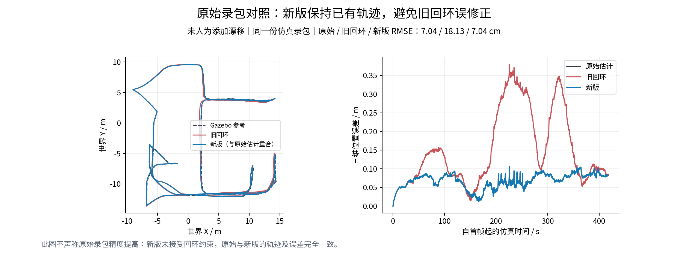
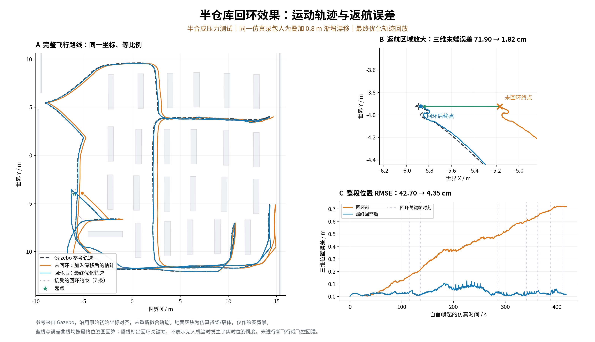

# FAST-LIO2 回环改进与真机接入方案

## FAST-LIO2 回环改进与真机接入方案

组会阶段报告｜AstraDroneOpen｜2026年10月22日｜建议汇报时间：10–12分钟

> 证据等级：已有仿真录包回放＋半合成人工漂移压力测试＋合成退化测试。尚无实体飞机实验，尚未启用回环对PX4的反馈或在线规划地图更新。

### 本阶段要回答的问题

无人机进入陌生室内环境后，既要主动探索和清除动态鬼影，也要控制累计定位漂移。回环的作用是利用重访区域约束历史轨迹；错误回环可能把原本较准的地图修坏。因此，本阶段重点是让回环有证据地纠偏，并拒绝证据不足的修正。

### 核心结果

| 输入与比较 | 整段三维位置RMSE | 结果解释 |
| --- | --- | --- |
| 原始仿真录包：原始估计 / 旧回环 / 新版 | 7.04 / 18.13 / 7.04 cm | 新版接受0条回环，保持原轨迹；证明避免了本例误修正，未证明厘米级精度提高。 |
| 同一录包＋人为0.8m渐增漂移：修正前→后 | 42.70 → 4.35 cm | 接受7条回环，RMSE降低约89.8%；这不是自然漂移的真机测量。 |
| 压力测试末端误差：修正前→后 | 71.90 → 1.82 cm | 终点改善与整段改善同时核验，避免只看返航终点。 |

### 已完成与下一步

- 已完成：改进独立回环后端、逐输入回执回放、轨迹绘图和原录包的离线维护图重建。
- 下一步：补齐非零回环修正下的动态地图一致重建，再以真实MID360采集的手持闭环验证自然漂移。
- 真机接入：先只检测和录包，再做手动飞行旁路评估；最后才考虑全局目标与连续局部控制的一致接入。

推荐组会主张：我们建立了能区分“明显漂移”与“残差尺度内微小修正”的回环验证流程，并在重复货架几何中验证了人工明显漂移的纠正能力。

## 1  系统问题、相关工作与方案选择

### 系统目标与当前矛盾

最终目标是在未知环境中自主探索、抑制动态物体鬼影，并在有限续航内输出较详细的静态点云。FAST-LIO前端提供连续局部里程计；后端回环处理长期一致性。定位修正、静态地图、动态物体轨迹和鬼影历史必须使用相容的坐标版本。

| 已有方案 | 机制与适配判断 | 本轮使用范围 |
| --- | --- | --- |
| FAST_LIO_SLAM [1] | FAST-LIO2与Scan Context/GTSAM后端分开；优化关键帧后重建地图。适合保留现有前端与外部鬼影维护器。 | 阅读作者README；没有安装或复现其性能。 |
| FAST_LIO_LC [2] | 半径候选、图优化，并反馈前端状态和地图；需要处理前端ikd-tree与外部维护图的一致更新。 | 阅读作者README；没有直接替换现有前端。 |
| VINS-Mono四自由度位姿图 [3] | 重力可观条件下优化位置和偏航。当前图没有IMU因子，保留前端重力方向可限制不合理倾斜。 | 核对optimize4DoF思想；自有实现，非作者代码移植。 |

### 本轮采用的架构

继续改进现有轻量后端，不引入GTSAM依赖。原始连续局部坐标仍叫map；独立全局优化输出使用loop_map。该命名是当前工程状态，不等同于已经完成标准map→odom TF链。

```bash
MID360点云/IMU → FAST-LIO → 连续局部里程计 map
                           ├→ 原射线证据维护图与鬼影历史
                           └→ 候选检索 → 几何验证 → 位姿图
                                              ↓
                                    全局定位 loop_map
                                              ↓
                            离线一致重建（已做原录包）
                            在线规划/飞控接入（待实施）
```

> 当前后端通过话题发布loop_map←map变换；没有广播这条TF，也没有把优化位姿回灌PX4。回环关键帧拼图包含原扫描痕迹，不能自动视为去鬼影地图。

### 贡献定位

Scan Context、ICP、点到平面、鲁棒图优化和重力保持都属于已有思想。本阶段属于面向仓库探索与动态地图维护的工程整合、失效分析和可复核验证；尚不能宣称新算法、首创性或真机泛化能力。

## 2  回环候选与几何验收

### 从相似视野到可信重访

旧后端在8m范围内搜索候选；半仓库内跨货架仍可能看到相似结构。源码和负结果支持这种风险存在，但本轮不是逐因素独立消融，不能把全部改善归因于某一个阈值。

| 环节 | 当前设置 | 目的 |
| --- | --- | --- |
| 关键帧 | 移动1.0m或转动10°；点云体素0.15m | 保留可用于几何核验的局部结构。 |
| 时空隔离 | 搜索半径2m；间隔≥20s且≥25关键帧；高度差≤1m | 减少相邻帧伪回环、远距离相似货架及不同高度匹配。 |
| MID360描述子 | 累计4关键帧；高度归一化Scan Context | 缓解非重复扫描及高度变化的描述子差异。 |
| 配准 | 粗ICP体素0.30m；细ICP体素0.12m；Huber点到平面精配准 | 粗搜索后再恢复局部几何；粗对应距离1.2m不作为验收精度。 |
| 独立几何验收 | 25cm匹配范围，重叠≥60%，匹配点RMSE≤14cm | 拒绝只靠小块或宽松对应产生的低分匹配。 |
| 退化检验 | 归一化点到平面信息矩阵最小/最大特征值≥1e-4 | 只看到平面时拒绝声称全部位姿可观。 |
| 留出帧复核 | 前一关键帧不参与源拟合；历史参考排除当前/留出帧 | 拟合之外复核，避免同一数据自我证明。 |
| 时序确认 | 两个不同关键帧修正差≤10cm且≤1°；回访冷却10关键帧 | 抑制单帧偶然匹配和重复相关约束。 |

### 前端与回环的栅格不应混为一个参数

外部维护图体素为0.15m；探索二维规划栅格约0.20m；回环关键帧体素0.15m、细ICP体素0.12m是不同用途。细配准体素小于关键帧体素不意味着凭空恢复了已下采样的信息。

### 边界与代价

2m候选范围可能漏掉更大漂移；多个几何检查仍可能被重复结构欺骗；累计描述子和多候选配准增加算力开销。阈值需要在真机自然漂移数据上重新验证，不能直接把仓库配置称为通用最优值。

## 3  图优化、修正门槛与坐标一致性

### 保留重力方向的四自由度图

当前后端没有IMU预积分因子。优化每帧XYZ和全局yaw，同时保持前端估计的重力方向，避免用自由横滚/俯仰弯折整段轨迹。它依赖前端重力可靠，不能修复IMU严重失准或外参错误。

位姿图代价增加、求解失败，或回环残余平移超过25cm/旋转超过3°时不提交结果。里程计平移/旋转平方根信息权重为30/400，回环为12/100；这些是工程权重，不是已标定的真实协方差。

### 残差尺度内的小修正不强行接受

```bash
平移门槛 = max(0.04 m, 2 × 配准RMSE)
旋转门槛 = max(0.3°, 2 × 配准RMSE / 点云均方根半径)
当平移和旋转修正都低于门槛时，拒绝本次微小修正。
```

这是分辨残差尺度的保守启发式，不是95%置信区间，也不能证明保留的小误差一定不是真实漂移。它的作用是在本例中避免追逐体素采样和几何残差。

### 局部控制与全局定位的关系

```bash
C(t) = T_opt(t) · T_raw(t)^(-1)
T_global_body(t) = C(t) · T_local_body(t)
全局目标换算：T_local_goal = C(t)^(-1) · T_global_goal
```

当前map充当连续局部里程计坐标，loop_map为可修正的全局坐标。REP-105区分连续局部odom与可跳变全局map [4]；后续可重命名以对应标准语义，但本轮没有改动既有控制链。

### 鬼影维护不能只跟着改一个位姿

离线重建对扫描、位姿和动态物体位置同步应用最终C(t)，再重新执行射线证据维护。在线版本还需给地图、历史观测和规划结果增加坐标版本；旧体素键和新坐标不能混用。目标做逆变换只保证坐标相容，并不自动保证控制连续，仍需暂停旧计划、重新规划和约束速度/加速度。

> 当前优化里程计不是已标定的飞控输入：twist/covariance等语义需另行审计；禁止据现有位姿话题直接推导“已可替代PX4定位”。

## 4  原始录包对照：先避免错误修正

### 实验协议

源航次：warehouse_half_ten_minute_20261022_111723。该航次已做传感器原点修正；本轮没有重新起飞。录包中扫描和位姿各4181条，原后端/新版均形成180关键帧；采用逐对回执与逐关键帧显式处理，保证对比不依赖丢帧或定时器抽样。

参考由Gazebo模型状态给出，只用于离线评估。沿用原始初始刚体对齐，不对每条结果重新拟合。模型状态没有消息头时间，使用录包接收时间；绘图样本最近参考时间差最大约1ms，仍存在时间语义与模型参考局限。

| 方法 | 三维位置RMSE | 接受回环 | 可作出的判断 |
| --- | --- | --- | --- |
| 原始局部里程计 | 7.04cm | — | 本录包的比较基线。 |
| 旧回环 | 18.13cm | 11 | 本例中回环反而降低轨迹精度。 |
| 新版回环 | 7.04cm | 0 | 拒绝证据不足的小修正，保持原轨迹。 |



图1　未添加人工漂移的同录包对照。新版与原始轨迹重合；红色为旧回环结果。

### 负结果也保留

只收紧点到点ICP的中间版本RMSE为30.80cm；点到平面但仍搜索8m的版本为22.24cm。后续近距离/两帧确认/保重力版本仍略差于原始值，最终增加残差尺度门槛后不再误修正。因为配置联合改变，这些是工程迭代记录，不是严格单因素消融。

## 5  人工漂移压力测试：验证明显漂移纠正

在同一份录包的位姿与已注册扫描中，同步加入沿局部X方向的平移：从首帧起400s线性增加到0.8m，随后保持。扫描与位姿同时平移，使机体系局部测量保持不变；真值不进入后端。

```bash
d(t) = 0.8 × clip((t − t0) / 400, 0, 1) m
p_raw(t) ← p_raw(t) + [d(t), 0, 0]
扫描世界坐标点执行相同平移；姿态不改变。
```



图2　半合成压力测试：完整轨迹、返航放大和误差曲线。橙线为人工漂移输入，蓝线为最终优化轨迹，虚线为参考。原图和SVG随材料附带，可放大查看。

| 指标 | 修正前 | 新版后端 |
| --- | --- | --- |
| 三维位置RMSE | 42.70cm | 4.35cm |
| 末端三维位置误差 | 71.90cm | 1.82cm |
| 有效输入 / 关键帧 / 回环约束 | 4181对 | 179关键帧，7条回环 |

> 边界：这是对既有录包的人为扰动，不是自然漂移的实飞结果；它没有覆盖旋转漂移、非线性偏差、长距离失配或传感器失真。蓝线按最终位姿图回算，GIF也不是在线修正过程。

## 6  地图、鬼影和证据完整性

### 轨迹改善与去鬼影地图改善必须分开验收

| 验证对象 | 本轮状态 | 仍缺少的证据 |
| --- | --- | --- |
| 原始录包，最终接受0回环 | 已完整重建维护图，并逐条确认三类输入回执。 | 该例没有实际全局变形，不能证明非零回环下的动态地图质量。 |
| 0.8m人工漂移，接受7回环 | 已完成轨迹评估与可视化。 | 尚未重建并评估与扰动输入完全一致的去鬼影维护图。 |
| 纯平面合成输入 | 拒绝退化匹配，0回环。 | 不能解决不可观方向漂移。 |
| 实体MID360/四旋翼 | 未做本轮真机测试。 | 自然漂移、误回环、算力、时延及控制稳定性。 |

### 已完成的维护图证据

原录包规范重放中，扫描、位姿、动态对象各4181条，共12543条输入均获得C++处理回执。最终维护图116608点，与未作坐标修正的规范重放PCD具有相同SHA-256。原飞行保存快照为116569点，不能把不同快照的点数混用。

| 地图指标 | 结果 | 含义 |
| --- | --- | --- |
| 静态碰撞几何10cm支持 | 99.664% | 有限保存点到参考几何的距离代理，不是鬼影分类正确率。 |
| 平均静态表面距离 | 1.941cm | 固定初始对齐、不额外ICP配准的几何一致性指标。 |
| 货架侧面支持 | 100% | 指定采样侧面和容差下的支持，不是完整三维覆盖率。 |
| 待查鬼影体素 | 7个 | 继续保留，不能宣称地图已经完全无鬼影。 |
| 限定行人离开路径残留代理 | 0 | 限定高度/距离/区域的代理，不等于全图零动态残留。 |

### 软件验证

已有编译检查通过。65项相关检查由12项回环工具与扰动路径隔离、16项鬼影复扫、34项任务回归、3项标定回归组成；它们不是65次飞行。报告、录包、配对路径、最终二进制和配置具有来源指纹；人工扰动路径默认禁止用于修正原始未扰动地图。

## 7  真实飞行器：先接通检测旁路

### 已知硬件与未决项

拟用MID360四旋翼。机载电脑型号仍需核验：此前“Jet Nano 16G”的描述不足以确定具体Jetson型号、系统版本和算力。因此本报告不宣称已经适配某款机载平台，也不将桌面回放耗时当作机载实时性能。

| 接口/标定项 | 上机前需核对 | 当前代码边界 |
| --- | --- | --- |
| 点云消息 | 话题名、消息包名、字段、逐点时间和驱动版本 | FAST-LIO源码当前订阅livox_ros_driver/CustomMsg；driver2需另核对消息适配。 |
| 真实传感器入口 | sim_lidar=false；匹配真实点云与IMU时间基准 | 真实分支lidar_type=1，仿真分支PointCloud2/lidar_type=4；不能混用。 |
| LiDAR–IMU外参 | 平移、旋转、时间偏移来自真实安装和采集 | 仿真配置mid360_sim.yaml及0.13m安装高度不能当成真机标定值。 |
| IMU–机体原点 | 确认机体轴与IMU轴、杆臂方向 | sensor_origin.hpp当前为轴对齐下的平移换算；非对齐需完整SE(3)外参实现。 |
| 射线起点 | 实际激光原点在局部里程计中的位置 | 地图维护与桥接节点必须使用同一组实测几何。 |
| PX4/MAVROS | 固件版本、坐标约定、时间/延迟与消息语义 | 官方文档区分ROS的FLU/ENU与PX4的FRD/NED；应由一致接口转换，避免重复转换。[5] |

### 首轮真机目标：检测与录包，不改变飞机控制

- 先在无飞行控制输出的状态下检查传感器、时间戳、外参和静止稳定性。
- 用手持闭环记录自然漂移，保留原始LiDAR/IMU、局部里程计、注册扫描、回环路径和诊断。
- 在真实机载电脑上测量前端频率、回环排队/配准时延、CPU、内存和温度，之后再安排人工驾驶旁路飞行。

真实安装标定与驱动核验完成后，可使用以下现有手持旁路入口；须先替换实测外参与两个桥接节点、维护器的真实杆臂参数。本轮未执行这些真机命令，未启动飞控控制器。

```bash
roslaunch fast_lio mapping_mid360.launch sim_lidar:=false
# 另一个已source工作空间的终端
roslaunch fastlio_bridge perception.launch \
  use_px4_initial_alignment:=false \
  publish_mavros_vision_pose:=false enable_loop_closure:=true
```

> 初始定位可使用任意局部原点；没有独立绝对参考时，不能依靠回环“获得绝对坐标”。不得用已依赖同一外部估计的PX4位姿循环证明定位精度。

## 8  真机试验与在线接入验收计划

以下为建议的下一阶段验收计划，尚未执行。每项应保存原始输入、版本、时间戳和失败例，不能只展示最佳路线。

| 阶段 | 试验内容 | 进入下一阶段的建议条件 |
| --- | --- | --- |
| A 静态/手持 | 静止、转动、短程往返；标定与时间诊断 | 明确消息与外参语义；无明显时间错位；独立参照可复查。 |
| B 手持闭环 | 至少3种闭环路线×3次，含货架和不同视角 | 逐条标注已接受约束，报告真/假回环计数、召回与自然漂移变化。 |
| C 相似但不重访 | 至少3种负路线×3次，含相邻货架/长墙/不同高度 | 首轮建议观察到0条错误接受约束；有限样本中的0不代表一般误检率为0。 |
| D 手动飞行旁路 | 保持原定位/控制输入，回环只记录 | 确认回环负载不破坏前端；报告P50/P95时延、消息间断、资源峰值和失败场景。 |
| E 非零修正地图 | 历史扫描/位姿/动态对象在同版本下重建 | 验证静态误删、鬼影残留、地图几何和历史待查状态，不仅检查终点。 |
| F 在线全局目标 | 双缓冲地图＋坐标版本＋目标重新投影/规划 | 原子切换地图和C(t)，废弃旧计划；验证目标/速度连续性后再评估闭环飞行。 |

### 建议记录的评价量

- 定位：若有独立动捕/测量基准，报告统一对齐的ATE、RPE和末端误差；只有闭环起终点测量时，只报告该项，不能替代整段ATE。
- 检测：人工/独立参考确认每条回环是否为真实重访，提供TP、FP、FN与计数定义，保留错误接受造成的图变形。
- 资源：前端接入前后频率与时延、回环候选耗时、配准耗时、排队长度、CPU/内存/温度；首轮可把前端频率保持在基线90%以上作为试验目标，非已达指标。
- 地图：固定参考几何误差、静态误删、动态残留和未解决疑点；真实标签不足时明确使用代理。

### 续航与探索策略

约10分钟续航下优先完成可达闭环主干和返航走廊，再补扫高价值疑点。回环不是每次都必需：证据弱或预算不足时保留局部一致地图并返航。触发阈值、观察停留和返航裕量需由真实电池负载与定位表现标定；本报告未新增能耗模型。

## 9  下次组会讲述顺序与可讨论问题

| 建议时长 | 讲述内容 | 可展示材料 |
| --- | --- | --- |
| 1分钟 | 目标与问题：为什么回环可能越修越差 | 第1、2页；旧/新对照。 |
| 2分钟 | 方法：候选、几何、时序确认、残差门槛 | 第3、4页参数与公式。 |
| 2分钟 | 原录包负结果和最终保守行为 | 图1：7.04 / 18.13 / 7.04cm。 |
| 2分钟 | 人工明显漂移压力测试 | 图2和assets/motion_playback.gif；明确半合成。 |
| 1分钟 | 地图与鬼影的验证边界 | 第6页：116608点、7待查，非零修正重建未验。 |
| 2分钟 | 真实MID360接入及接下来要做的实验 | 第7、8页分阶段计划。 |

### 建议在组会直接回答的三个问题

问：既然新版在原录包中没有触发，是否只是关闭了回环？答：本例拒绝了小修正，但同一仓库几何的0.8m扰动测试接受了7条约束并改善整段轨迹；说明机制能工作。仍需真实自然漂移数据验证门槛是否过于保守。

问：能否说已解决真机回环？答：不能。目前完成的是独立后端和仿真录包验证。消息适配、真实外参、自然漂移、机载实时性以及在线地图/目标更新都需要单独验收。

问：回环后是否一定无鬼影？答：不是。回环与动态点清理是不同环节；当前原录包仍有7个待查体素，人工明显漂移下的完整去鬼影地图还未验证。

### 建议下一轮优先级

- P0：在离线环境补齐非零修正条件下的扫描/动态对象/射线/鬼影账本一致重建，并加入可核对的静态误删和动态残留评价。
- P1：确认真实MID360消息与全SE(3)安装外参；采集真实手持闭环和相似结构负样本。
- P2：测量真实机载电脑负载与队列延迟；自然漂移数据上做单因素消融和重复试验。
- P3：原子地图版本切换、连续局部控制与全局目标更新；这一步完成前，保持回环旁路。

## 附录  复现入口、证据与参考来源

### 已验证的离线复现入口（不会启动飞行）

```bash
cd /home/a/AstraDroneOpen
RUN=half_warehouse_ten_minute_runs/
RUN=${RUN}warehouse_half_ten_minute_20261022_111723
bash scripts/run_sh/half_warehouse_loop_replay_demo.sh "$RUN"
```

### 人工漂移测试与绘图

```bash
source AstraDrone_ros1_ws/devel/setup.bash
/usr/bin/python3 evaluation/half_warehouse/replay_loop_backend.py \
  --prefix "$RUN" --inject-x-drift 0.8 \
  --output /tmp/warehouse_loop_drift_test
/usr/bin/python3 evaluation/half_warehouse/plot_loop_motion.py
```

人工扰动路径不能直接用于修正原始未扰动地图。真实硬件首轮先核对驱动和外参，再使用真实分支sim_lidar=false；此处不提供未经实机验证的解锁或Offboard命令。只读准备度工具见evaluation/FLIGHT_READINESS.md，检查通过也不代表飞行许可。

### 本项目证据索引（相对项目根目录）

- evaluation/reports/20261022_loop_verification.json：汇总、范围与二进制/配置SHA。
- evaluation/half_warehouse/reports/20261022_loop_verified_warehouse_report.json：原录包后端。
- 同目录20261022_loop_stress_warehouse_report.json：人工0.8m扰动结果与来源。
- 同目录20261022_loop_verified_map_quality.json、20261022_loop_verified_surfaces.json：维护图与几何代理。
- 同目录20261022_loop_motion_verification.json：绘图指标复核和图像来源。

### 参考来源与阅读范围（2026-10-22核实）

[1] FAST_LIO_SLAM作者仓库与README。https://github.com/gisbi-kim/FAST_LIO_SLAM

[2] FAST_LIO_LC作者仓库与README。https://github.com/yanliang-wang/FAST_LIO_LC

[3] VINS-Mono作者pose_graph.cpp，optimize4DoF思想；未复现其系统。https://github.com/HKUST-Aerial-Robotics/VINS-Mono

[4] ROS REP-105官方源码镜像，坐标语义。https://github.com/ros-infrastructure/rep/blob/master/rep-0105.rst

[5] PX4官方External Position Estimation文档，坐标与MAVROS接口；实际部署须匹配所用固件版本。https://docs.px4.io/main/en/ros/external_position_estimation

> 本报告没有新增学术性能主张。工程完成、单元检查、录包回放、仿真飞行与真机飞行是不同证据等级；材料中的动图是最终优化轨迹回放。

