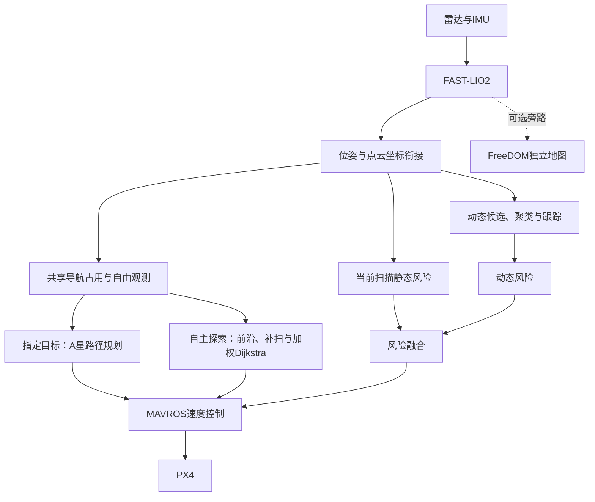

# 项目接管：现状、待办与改进路线

核验日期：2026-10-16，Asia/Shanghai。范围：当前本地源码装配、两份完整交流记录、已有原始结果文件和作者/官方资料。本轮没有改动飞行程序，没有重新编译、飞行、回放或测资源。

当前判断：项目已经形成了动态环境无人机定位、地图维护、导航与自主探索的仿真原型。下一阶段应优先完成故障处理闭环、统一实验和地图质量诊断，再形成一个可验证的研究问题。

## 1. 我接管的项目范围

| 工作线 | 当前已具备的内容 | 继续承担的任务 |
|---|---|---|
| 基础飞行与传感器 | ROS1、PX4/MAVROS、Gazebo、MID360仿真、起飞/键盘/指定航线 | 启动可靠性、坐标和时间一致性、实物输入适配 |
| 定位建图 | FAST-LIO2前端、独立内部匹配地图 | 真实MID360时间字段、外参、去畸变和定位质量核验 |
| 动态感知 | 背景候选、聚类、关联、速度拟合、运动确认与显示 | 初始化吸收站立人、漏检/误检、遮挡和关联质量 |
| 可修改地图 | 共享占用体素、多用途视图、自由空间证据、旧占用撤销 | 静态误删与鬼影残余的成对评价、删除原因追踪 |
| 指定目标导航 | 高度带二维A*、扩域、路线保持、局部修图、航点执行 | 地图时效、未知空间规则、同版冷启动多目标回归 |
| 自主探索 | 加权Dijkstra、前沿收益、补扫、返航、驻留与保存 | 安全恢复、长程返航可靠性、缺架诊断与自然收敛 |
| 外部基线 | FreeDOM独立旁路建图及导出 | 同输入审计、资源统计，后续再考虑地图驱动导航对照 |
| 回环后端 | 关键帧、Scan Context、ICP、鲁棒位姿图及重建 | 误回环、最终历史轨迹评估、动态清理证据一致性 |
| 工具与材料 | 场景/行人、bag/PCD、图文、PPT、讲稿、源码盘点 | 版本索引、尚未应用的PPT审查意见、数据归档 |

已完成的材料无需重新制作；未完成的算法和验证按下面优先级推进。历史上传、改main的说明和素材清理不作为本轮自动发布或删除指令。

## 2. 当前实际系统

图中指定目标规划器与自主探索器是两种任务入口，分别运行时由对应模块独占航点输出。FreeDOM不参与当前探索控制；回环主链默认关闭，未画入默认主链。

核心代码在 `AstraDrone_ros1_ws/src/SLAM/fastlio_bridge/`。其中：

- `src/dynamic_detector.cpp`、`dynamic_cluster.cpp`：候选、关联与运动确认。当前没有默认部署人体语义网络；独立遗留跟踪文件不代表实际被启动。
- `src/static_map_builder.cpp`：同一 `cells_` 派生持续、稳定、局部占用；`latest_free_cells_` 单独保存自由候选。前端ikd-Tree另行维护，清理导航地图不自动清理前端树。
- `src/static_path_planner.cpp`：指定目标二维A*；不是当前启用的EGO-Planner系统。
- `scripts/warehouse_explorer.py`、`exploration_grid.py`、`exploration_coverage.py`、`src/exploration_search.cpp`：自主选点、带代价搜索、表面观测证据和任务状态机。
- `src/static_collision_risk.cpp`、`collision_risk.cpp`、`avoidance_fusion.cpp`、`mavros_avoidance_controller.cpp`：即时风险与执行保护。

当前探索使用0.20米栅格、0.80米正常规划净距、约0.40米机体圆包络、0.30米/秒导航速度上限；这是配置，不是实际平均速度或安全证明。固定高度规划限制了可达视点和遮挡面的观测能力。

任务类型与地图策略是两个维度：普通导航默认仍有轨迹辅助清理；探索启用严格观测证据清理。后者不以动态轨迹圆柱直接授权删除，使用时间配对、真实回波、邻格保护与有时效的多次空证据。统一策略要经过两类任务回归，保留原消融版本。

当前仿真使用MARSIM分支，点时间字段置零且跳过逐点反向去畸变。不能将仿真定位结果直接作为真实MID360补偿有效的证据。演示launch还关闭了通过bridge向MAVROS反馈vision pose，实物无GPS定位与飞控估计器闭环仍须单独核验。

## 3. 已有证据与较新负结果

### 3.1 内部组合对照，2026-09-23

| 指标 | badcase | ours |
|---|---:|---:|
| 到达用时，仿真秒 | 61.698 | 37.377 |
| 真值平面路程，米 | 20.296 | 12.423 |
| 指定旧位置稳定地图点数 | 128 | 0 |
| 终点里程计平面误差，米 | 0.132 | 0.171 |
| 最小人机中心平面距离，米 | 0.979 | 0.965 |

来源：`dynamic_demo_runs/badcase_20260923_201211_metrics.json`、`ours_20260923_200322_metrics.json`。各一次、地图清理与局部重规划组合开关，实际轨迹与观测不同。可以展示该样本路线和局部残影改善，不能分解单模块收益、宣称定位提升或统计优势。

### 3.2 长程自主探索，2026-10-03

`exploration_demo_runs/warehouse_20261003_222021_result.json`：

- 到达93个/选择97个观察目标，里程计累计平面航程547.882米，返航平面误差0.12256米。
- `termination=returned_home_and_saved`、`home_confirmed=true`，保存284418点。
- 同时 `finish_reason=wall_budget_partial`，`exploration_complete=false`、`coverage_complete=false`。
- `stalled_goals=3`是目标进度失败计数，不能称确切三次重规划。

同轮货架侧面代理：ours 9267/10192=90.92%，FreeDOM 10091/10192=99.01%；最差单架29.59%/85.71%，10/3架低于90%。双方都未通过“总体≥95%且每架≥90%”。FreeDOM是旁路，两图密度与入图规则不同，不能作动态分割或整体系统排名。参考仅为声明高度带的碰撞盒侧面，不是全三维mesh完整率或误删率。

### 3.3 接管时额外核对的结果

| 场次 | 原结果 | 解读 |
|---|---|---|
| 2026-10-05 120756探索 | `stalled_unsafe`、0目标到达、`failed=true` | 说明后续仍存在恢复失败；需诊断该原场次，不能沿用10/03成功概括全部运行 |
| 2026-10-11 194618仓库导航 | 到达，40.27仿真秒，9.933米，末端误差0.063米 | 另一次导航功能证据；没有有效旧位置残影指标，不计作动态清图成功 |
| 2026-10-14 200842探索 | 中断，5/9到达，3个停滞目标，未确认返航 | 只支持部分探索；侧面支持65.82% |
| 2026-10-14 205420探索 | 中断，4/5到达，未确认返航 | 只支持部分探索；侧面支持42.81% |

中断场次的 `failed=false` 仅说明运行器未置异常标志，不代表任务成功；不同预算与航线不能作覆盖率升降对比。这些原文件已进入本轮核验摘要，未重新运行实验。

### 3.4 回环

`loop_closure_runs/loop_closure_20260923_182256_report.txt`中的在线轨迹ATE为0.0113→0.0478米，接受2条约束。它证明存在误约束风险，不能声称后端提高精度。历史最终Path重评与在线输出口径不同，本轮没有重新算bag。主链继续默认关闭，后端专项保留。

## 4. 接管后优先处理的缺口

| 优先级 | 当前问题与证据位置 | 建议改法 | 验收边界 |
|---|---|---|---|
| P0 | 静/动态风险输入失效时仍可发布SAFE；融合对失效来源降SAFE。`static_collision_risk.cpp:456`、`collision_risk.cpp:451`、`avoidance_fusion.cpp:169` | 将“无障碍”和“输入不可用”分开，传播采集时间与有效性；控制层按数据缺失状态处理 | 输入断流、节点停止、延迟重发、有效空观测分开测试；需要经过真实融合装配 |
| P0 | 二级静态输出`static_emergency`，探索恢复只接受`static_avoid`。`avoidance_fusion.cpp:205`、`mavros_avoidance_controller.cpp:267/648` | 明确一级/二级恢复授权接口，保留新扫描、同目标、无动态风险和净距复核 | 测融合→控制器真实链路，不能只人工注入来源字符串验证；本轮未修复 |
| P0 | 普通规划器缓存占用/自由图无年龄门控；旧证据仍可用于新航点。`static_path_planner.cpp:182/653` | 分别管理全局背景、当前局部图、自由证据的采集时刻与有效期；过期自由证据不授权开通 | 停止局部/自由发布、旧消息重发、恢复输入；历史全局图不应仅因年代久就整图失效 |
| P1 | 地图缺架无法分离漏看与误删，补扫只统计当前仍存在的表面 | 记录新建/命中/删除原因与观测来源，保留有界的已观测表面历史；可疑缺失生成待核验任务 | 同输入比较累积扫描与维护地图，当前真实障碍仍优先；历史记录不能永久阻挡已经证实空闲处 |
| P1 | 初始化40个非空扫描回调做背景并集，无静止性门控 | 背景初始化状态可观测化，研究逐体素时序支持和暂停后运动重新检出 | 静止人→运动、启动时有人横穿、自运动、薄结构分别测误检/漏检 |
| P1 | 长程恢复/返航可靠性不充分，10/05有失败 | 将失败快照变成可复现用例，检查恢复方向、控制授权及路径连通；增加返程可行性监测 | 最终同版冷启动多次完整任务，保留全部失败；10/03单次成功不是通过标准 |
| P1 | 缺少同输入外部对照与资源数据 | 录原始扫描、IMU、位姿、TF、真值/事件；统一体素与评价口径，做单模块消融 | 成对报告静态保留、动态残影、清除/恢复延迟、任务与资源；离线回放不替代闭环 |
| P2 | 全图重复遍历/发布、完整KD-tree重建与重复搜索可能耗时 | 先逐节点计时，再按变化块更新、复用局部索引、分离显示与安全频率 | CPU/PSS、P95/P99、输入积压和端到端数据年龄；保留相同安全余量 |
| P2 | 回环误匹配与清图证据未统一 | 候选真值、最终Path三维误差、退化/一致性门控与子地图证据关联 | 无收益时继续保持专项；不能靠放宽阈值增加回环数交差 |
| P2 | Gazebo原生退出异常历史未根除 | 最小场景/插件组合复现、保存卸载栈 | 单独验收启停可靠性，不将卸载异常混作飞行中故障 |

现有watchdog主要发布诊断，不能把它的存在当作上述失效状态已经传到控制器的证明。

## 5. 最值得集中投入的研究方向

建议主线：**面向任务恢复的失效历史占用主动核验**。

研究问题可以表述为：在人或物体曾经静止、后来离开而部分区域又被遮挡时，无人机如何用有限观测预算确认旧障碍已消失，同时保留真实货架，并恢复受影响的路线？

可沿当前代码推进：

1. 为旧占用维护“仍有支持、出现矛盾但证据不足、已经满足撤销条件”的证据状态；即时扫描中的真实障碍独立保留。
2. 识别哪些待核验区域正在阻断目标/返程或造成明显绕行。
3. 在已观测可通行空间中选择能看清这些区域的视点；把核验收益、飞行代价、数据时效和风险一起评价。
4. 看不清时继续保守处理；满足证据后撤销，再评价通路恢复时间。
5. 在相同静态误删水平、相同速度/净距/观测预算下，与被动清图、普通前沿或最近视点策略比较。

这些宽泛思想已有相关研究，尚不是已实现的新算法或已证实创新。FreeDOM和DUFOMap已经处理自由空间与动态地图，不能只靠“射线、置信度、主动观察、MID360”命名新贡献。具体机制需再做定向论文检索、强基线和消融后确定。

推荐实验顺序：静态薄结构+自运动 → 人先静止后离开 → 人仍站着/旧位置被遮挡 → 旧占用堵住关键通道 → 多布局长程探索与返航。起步每组至少5次独立运行，按离散性增加样本；次数本身不保证统计结论成立。

保留的两个后续方向：

- **真实传感器与边缘部署**：先验证MID360逐点时间、同步、外参和真实输入回放，再测目标硬件P95/P99、内存、热降频；随后进入分级实物闭环。语义人体类别与当前运动状态分开，人体静止时仍是即时障碍。
- **长期地图与回环一致性**：在回环约束可靠后，将清理证据关联关键帧/子地图，避免重建让人体旧点复生。当前不适合同时把这一方向扩成论文主线。

## 6. 四阶段推进与交付门槛

| 阶段 | 交付 | 通过后再进入下一阶段 |
|---|---|---|
| A：可靠性 | P0三项接口修正、真实融合链回归、10/05失败场次复现 | 输入失效可识别、受限恢复可达、旧自由证据不误开路 |
| B：实验基座 | 固定代码/参数/依赖清单、原始输入、事件记录、统一报告与资源计时 | 任何结果可追到版本与输入；任务成功和地图质量分别判定 |
| C：方法研究 | 删除原因与缺失归因、任务相关核验、统一外部地图基线与消融 | 同预算且静态误删匹配时确有收益，否则调整或收窄选题 |
| D：迁移与扩展 | 真实MID360、目标板卡、三维轨迹/覆盖和可选回环 | 每项按自身范围验收，不能用仿真渲染或bag回放代替实飞 |

三维轨迹规划应在数据/控制接口稳定后接入。目录存在EGO-Planner且有CATKIN_IGNORE，不表示已经使用；换规划器还需重新验证轨迹、风险和执行接口。

## 7. 工程、备份和材料状态

- 本地HEAD为`8808ad5`；算法核心目录相对HEAD没有本轮前的新差异，但有大量已暂存/未跟踪的文档素材和运行日志。未修改用户索引、未提交或推送；远端状态本轮未核验。
- 当前磁盘可用约55GiB，Git报告garbage=0。不需要重复清理历史；后续将bag/PCD/大录像与源码分别归档，保存哈希和实验清单。
- 历史记录提到的`/home/a/AstraDroneOpen_backups`在当前环境不存在。只能认定该路径当前不可见，不能断言文件已删除或仍有可恢复完整备份。应核对挂载/迁移去向并重新建立当前版本的可恢复备份。
- 最新59页修订版：`/home/a/下载/组会_第44及58至59页重制_59页完整版.pptx`，当前存在；只局部重做44、58、59页，其余历史审查问题不能视为已经解决。
- 选点公式8页：`/home/a/下载/黑箱地图探索_选点公式与解释_组会风格_8页.pptx`，当前存在，独立交付，未自动合并进59页。
- 启动操作统一入口：`docs/演示启动命令/所有Demo与行人启动命令.md`。后续维护该索引，避免继续产生不一致命令。

ROS Noetic已于2025-05-31结束支持，Gazebo Classic于2025年1月结束支持。近期先固定现有研究环境和依赖来源，中期逐个模块抽离ROS接口、迁移到受维护的平台，避免迁移与新算法一起改变而无法归因。

## 8. 本轮核验的实际范围

完整读取AGENTS与两份记录到EOF，补读截断内容；核对当前launch/config、风险/控制/地图/规划/探索关键代码与真实结果JSON，检查较新场次和交付文件存在性。旧地图PCD的元数据和结果被读取，本轮没有重新计算全PCD覆盖，也没有重新计算回环bag。没有声称本轮编译、SITL、接触安全、真机或机载性能通过。

外部来源于2026-10-16读取，范围为作者README与官方维护公告，不是全文复现或穷尽新颖性检索：

- [FreeDOM作者项目](https://github.com/LC-Robotics/FreeDOM)：静态地图动态去除和评价接口；已经是当前基线来源。
- [DUFOMap作者项目](https://github.com/KTH-RPL/dufomap)：动态地图、MID360展示及统一数据输入，作为下一基线候选，尚未接入本项目。
- [ROG-Map作者项目](https://github.com/hku-mars/ROG-Map)：滑动地图、增量膨胀和前沿更新，作为优化设计参照，尚未替换本地图。
- [ROS Noetic结束支持公告](https://discourse.ros.org/t/ros-noetic-end-of-life-may-31-2025/43160)。
- [Gazebo Classic官方维护状态](https://classic.gazebosim.org/)。

本报告的改法与阶段门槛均为建议待实施；只完成接管盘点、证据整理和记录，不将其写成算法修复完成。
